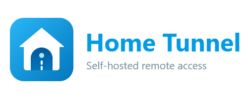
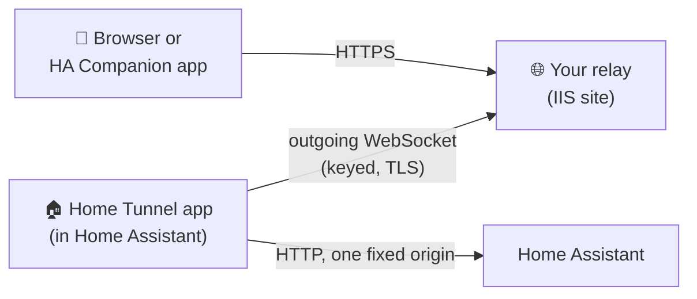
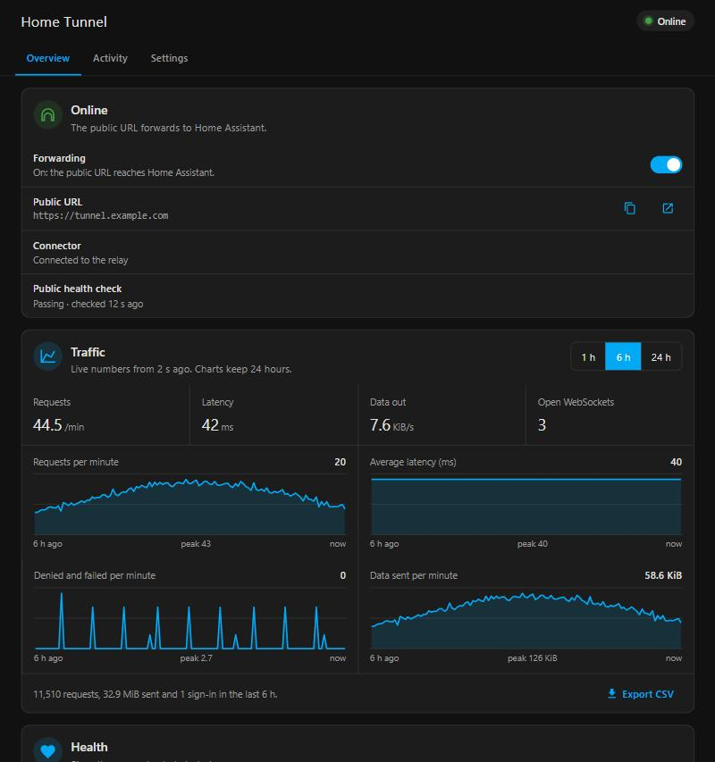
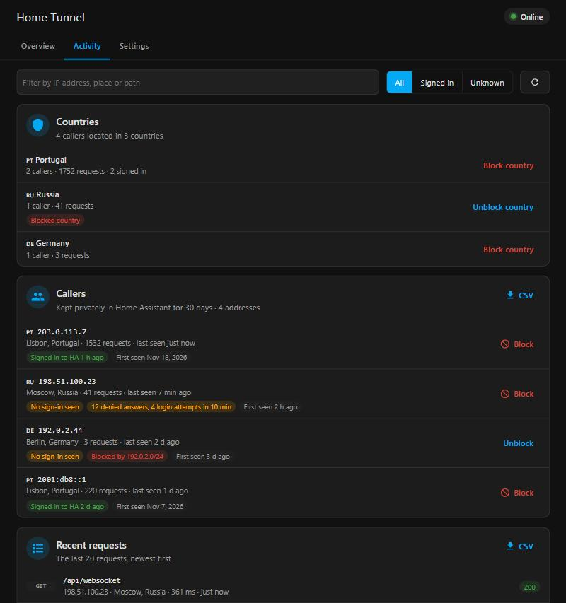
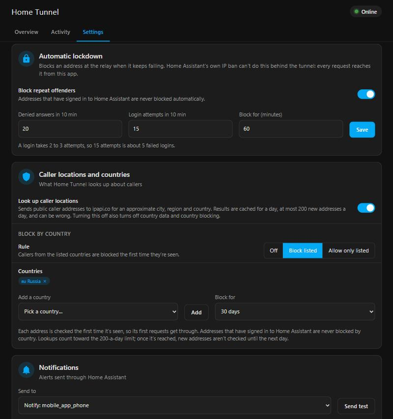

<p align="center">
  
</p>

<p align="center">
  <a href="https://github.com/amartins14/HA-Home-Tunnel/releases/latest"></a>
  <a href="https://github.com/amartins14/HA-Home-Tunnel/actions/workflows/verify.yml"></a>
  
  
  
  <a href="LICENSE"></a>
</p>

<p align="center">
  Reach your Home Assistant from anywhere through a relay <b>you</b> host.<br>
  No open ports at home, no third-party cloud. Home Assistant still handles every sign-in.
</p>

<p align="center">
  <a href="https://my.home-assistant.io/redirect/supervisor_add_addon_repository/?repository_url=https%3A%2F%2Fgithub.com%2Famartins14%2FHA-Home-Tunnel"></a>
</p>

---

## How it works



The **Home Tunnel app** runs inside Home Assistant and opens one outgoing, encrypted WebSocket to a **relay** on a web host you control. Visitors reach the relay's HTTPS address; the relay passes their requests down that WebSocket, and the app forwards them to Home Assistant, and nowhere else. Because the connection starts from home, nothing needs to be opened on your router.

The relay is not a login system. Home Assistant's own sign-in, MFA and user permissions apply to every request, exactly as on your home network.

## Screenshots

| Overview | Activity | Settings |
| --- | --- | --- |
|  |  |  |

The dashboard opens from the Home Assistant sidebar and follows your Home Assistant theme.

## Features

| | |
| --- | --- |
| 🔌 **Tunnel control** | One switch turns public forwarding on or off. A live health check confirms the public address really reaches your Home Assistant. |
| 🔐 **Paired, not configured** | The app and relay pair with a one-time setup code using challenge-response; the code itself never leaves Home Assistant. Rotate the connector key or unpair from the dashboard. |
| 📈 **Traffic history** | Requests, latency, data sent, denied and failed answers, and sign-ins, kept per minute for 24 hours. |
| 👥 **Who's calling** | Every caller address for 30 days, with request counts and whether it ever signed in to Home Assistant. Optional city and country lookups. |
| ⛔ **Blocking** | Block an address or range at the relay, for an hour, a day or for good. Blocked callers never reach Home Assistant. |
| 🛡️ **Automatic lockdown** | Blocks an address after too many denied answers or login attempts. Home Assistant's own IP ban can't do this behind a tunnel, because every request reaches it from the app. |
| 🌍 **Country rules** | Block listed countries, or allow only the ones you list. Addresses that have signed in are never blocked. |
| 🔔 **Notifications** | Through Home Assistant: tunnel offline, new sign-in location, attacks, blocks, relay updates and an expiring HTTPS certificate. |
| 📤 **CSV export** | Callers, recent requests and traffic history. |
| 📊 **Entities (optional)** | The Home Tunnel integration adds status, traffic and security sensors to Home Assistant. |

## Get started

**You need**

- Home Assistant OS or Supervised, version 2026.9 or newer, on `aarch64` or `amd64`.
- A Windows web host with IIS, ASP.NET Framework 4.8, WebSockets and URL Rewrite, where the site can write to its own `App_Data` folder. Shared hosting works if it allows that.
- A hostname for the relay with a valid HTTPS certificate.

**Set it up**

1. **Install the app.** Use the button above, or in Home Assistant go to **Settings → Apps → Install app → ⋮ → Repositories** and add `https://github.com/amartins14/HA-Home-Tunnel`. Install **Home Tunnel** and start it.
2. **Deploy the relay.** Download `home-tunnel-relay-<version>.zip` from the [latest release](https://github.com/amartins14/HA-Home-Tunnel/releases/latest) and copy its contents to your IIS site's root. See the [relay deployment guide](docs/RELAY-DEPLOYMENT.md).
3. **Pair.** Open **Home Tunnel** from the sidebar and follow the three setup steps: create a setup code, paste the `web.config` line it gives you into the relay, then enter the relay's address.
4. **Turn on forwarding** once the connector shows as connected, then sign in to Home Assistant from outside your network to check it works.

The app's **Documentation** tab in Home Assistant walks through every screen.

## Updating

- **App:** Home Assistant offers updates under **Settings → Updates**, like any other app.
- **Relay:** updated by hand. The dashboard tells you when a new relay is out and links to the release. Copy the new `App_Code` files over the old ones and leave `web.config` and `App_Data` alone. See [Updating the IIS relay](docs/RELAY-DEPLOYMENT.md#updating-the-iis-relay).

## Optional: sensors in Home Assistant

[](https://my.home-assistant.io/redirect/hacs_repository/?owner=amartins14&repository=HA-Home-Tunnel&category=integration)
[](https://my.home-assistant.io/redirect/config_flow_start/?domain=home_tunnel)

The **Home Tunnel** integration reads the app's private metrics and creates status, traffic, latency and security-review sensors. Install it through HACS as a custom repository, set a `metrics_token` in the app's **Configuration** tab, then add the integration with the app's hostname, port `8100` and that token. The dashboard doesn't need it.

## Security at a glance

- Only outgoing connections leave your network. The relay can reach exactly one Home Assistant address, chosen in the app, never by a request.
- The connector runs unprivileged, with no Home Assistant API access, and checks that before it connects.
- The setup service has Home Assistant API access only to send notifications; it keeps that token away from the connector.
- Forwarding starts off after pairing, and the relay refuses anything once forwarding is off or the connector is gone.
- The relay host can see traffic after TLS ends there, so run it somewhere you trust.

Read [SECURITY.md](docs/SECURITY.md) before you expose Home Assistant.

## Documentation

| | |
| --- | --- |
| [Architecture](docs/ARCHITECTURE.md) | How the app, connector and relay fit together |
| [Configuration](docs/CONFIGURATION.md) | App options, dashboard settings and key files |
| [Relay deployment](docs/RELAY-DEPLOYMENT.md) | Installing and updating the IIS relay |
| [Security](docs/SECURITY.md) | What is protected, what is stored, and the limits |
| [Changelog](CHANGELOG.md) | Release notes for the app and relay |
| [Contributing](CONTRIBUTING.md) | Checks and the release process |

## Repository layout

| Path | What it is |
| --- | --- |
| `home-assistant/` | The Home Assistant app: setup service, dashboard and connector |
| `relay/` | The IIS relay: ASP.NET handlers and `web.config` |
| `custom_components/home_tunnel/` | Optional integration that adds sensors |
| `tests/` | Python checks for the app and C# checks for the relay |
| `docs/` | Guides and images |
| `tools/rotate_key.py` | Legacy manual key tool; the dashboard rotates keys now |

## Development

```sh
python3 -m venv .venv
.venv/bin/python -m pip install -r requirements-test.txt
.venv/bin/python -m unittest discover -s tests -v
```

The relay checks compile with the .NET Framework 4.8 compiler on Windows; [CONTRIBUTING.md](CONTRIBUTING.md) has the command and the release process. GitHub Actions runs both on every push.

## License

[MIT](LICENSE). Home Assistant is a trademark of the Open Home Foundation; this project is not affiliated with it.
