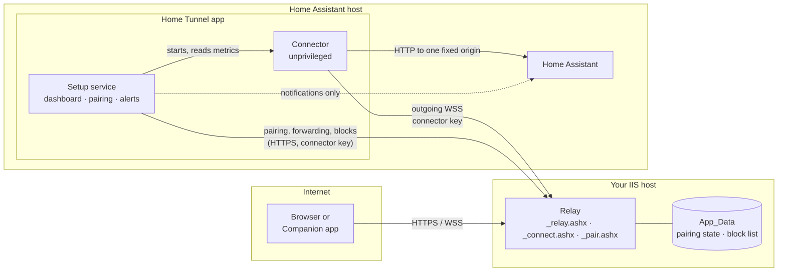

# Architecture

## Parts

**Relay** (`relay/`): classic ASP.NET handlers on IIS.

- `_relay.ashx` receives every public request (URL Rewrite sends everything there). It turns away blocked addresses, refuses everything while forwarding is off or the connector is missing, limits concurrency, and passes requests to the connector as framed messages.
- `_connect.ashx` accepts the connector's WebSocket when it presents the connector key.
- `_pair.ashx` handles pairing (challenge, claim, finalize), forwarding on and off, the version check, key rotation, unpairing, the block list and the list of refused WebSockets. Everything after pairing needs the connector key.
- State lives in `App_Data`: `home-tunnel-state.json` holds the origin, a hash of the key and the forwarding flag; `home-tunnel-blocks.json` holds the block list the app sent.

**Connector** (`home-assistant/connector/connector.py`): runs as an unprivileged user with no capabilities, no Home Assistant configuration folder and no Home Assistant API token, and checks all of that before connecting. It validates every frame from the relay, joins each request path to the one configured Home Assistant origin, rejects redirects, and only allows Home Assistant's WebSocket and WebSockets below an app web UI's ingress address (no percent-encoded or dot segments). The relay applies the same rule and remembers its last 20 refusals for the dashboard. It also probes its own public address to prove requests return through this connection, and serves read-only metrics on the private app network (`metrics.py`, port 8100): per-caller history, 24-hour traffic and lockdown candidates.

**Setup service** (`home-assistant/connector/service.py`): serves the dashboard through Home Assistant ingress (port 8099, reachable only from the Supervisor's ingress proxy) and supervises the connector process. Background tasks:

- pairing, finalizing, and finishing interrupted key rotations;
- checking the relay version every 5 minutes and its HTTPS certificate every 6 hours;
- every 15 seconds: applying automatic lockdown and country rules, sending the block list to the relay when it changes, and raising notifications;
- every minute: fetching the relay's refused WebSocket list for the Activity page;
- monthly: downloading DB-IP's free country database, which `countrydb.py` loads into compact arrays (about 15 MB) for offline country lookups.

It holds the Home Assistant API token (from `homeassistant_api`) for notifications only. `start.sh` hands it the token under a private name; the service removes it from its environment, never passes it to the connector, and marks itself non-dumpable so the connector can't read it from `/proc`.

**Integration** (`custom_components/home_tunnel/`): optional. Polls the metrics endpoint and exposes sensors and a binary sensor.

## Pairing

1. The app creates a 256-bit setup code. You put `sha256(code)` in the relay's `web.config`.
2. The app sends a nonce and its origin; the relay answers with its own nonce and an HMAC proving it knows the hash.
3. The app checks that proof, sends its own, and both sides derive the connector key. The relay stores only a hash of it.
4. The app finalizes; from then on the relay refuses new pairings until it is unpaired.

The code itself is never sent. Rotation asks the relay for a new key, which works alongside the old one until the app confirms it; the relay then drops the connector so it reconnects with the new key.

## Blocking

The app owns the block list: manual blocks, automatic lockdowns and country blocks. It sends the whole list to the relay whenever it changes and every 5 minutes. The relay enforces it before anything else, including the forwarding check, and re-reads it every 30 seconds so every IIS worker agrees. Lockdown and country rules need data only the app has: which addresses signed in to Home Assistant, failed requests per caller, and locations. That's why they run in the app, not the relay.

## Hosting

The relay targets IIS with classic ASP.NET Framework 4.8. Hosting it elsewhere would need a new implementation of the same protocol and isn't supported. TLS ends at IIS or whatever is in front of it, so the relay host can see proxied traffic.
